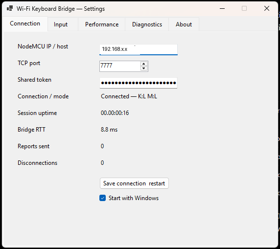
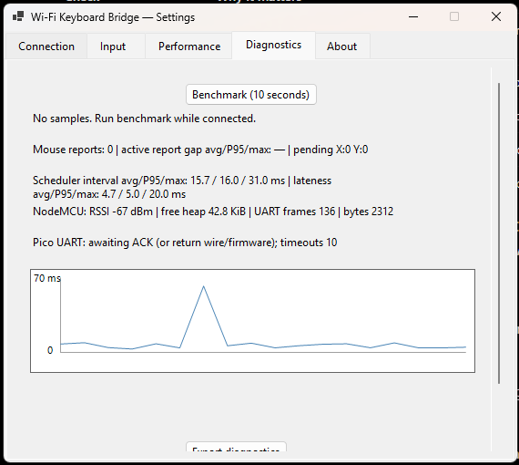
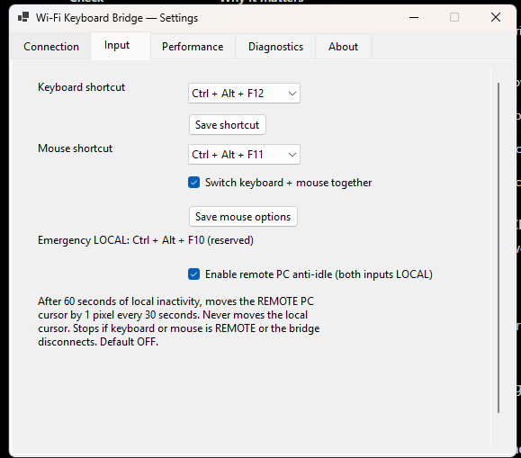

# Wi-Fi Keyboard Bridge

A Windows keyboard and mouse bridge for a second computer without installing
software on that computer:

**Main Windows PC → Wi-Fi → ESP8266 NodeMCU V3 → UART → Raspberry Pi Pico RP2040 → USB keyboard + mouse HID → receiving PC**

Developed by [axw13](https://github.com/axw13).

**Project status:** Hardware-tested release-candidate baseline. The Windows
client, USB HID forwarding, numpad mapping, Pico UART diagnostics, and remote
anti-idle were tested in the author's setup. Hardware variants and
platform-specific behavior may differ.


### Custom shortcuts and typed switching

In **Settings → Input**, click **Record** beside keyboard, mouse, or emergency-local shortcut, then hold a modifier (Ctrl, Alt, Shift, or Win) and press the desired key. Press Escape to cancel. Conflicting combinations are rejected. **Ctrl+Alt+F10 always remains an emergency LOCAL fallback**, even after customizing the visible emergency shortcut.

You can also configure a lowercase letter sequence (4–32 characters), for example `asdffdsa`, to switch **both** keyboard and mouse between LOCAL and REMOTE. The sequence is detected by the Windows client within a 2-second typing window and is passed through normally to the current PC, so it can appear in text fields. Clear the field to disable this trigger. This feature runs entirely in the Windows client and does not change NodeMCU/Pico firmware or mouse pacing.

## Application screenshots

The screenshots below show the Windows configuration and monitoring interface.
Connection details are redacted for public documentation.

| Connection | Diagnostics | Input |
|---|---|---|
|  |  |  |

## Features

- Independent keyboard and mouse REMOTE/LOCAL switching, or linked mode
- Emergency **Ctrl+Alt+F10** returns both devices to LOCAL
- Default shortcuts: keyboard **Ctrl+Alt+F12**, mouse **Ctrl+Alt+F11**
- Raw Input mouse motion, configurable sensitivity and manual 30/60/90/125 Hz
  update target; adaptive mouse pacing optional and OFF by default
- Numeric keypad input with scan-code handling for Num Lock
- Connection telemetry, Wi-Fi RTT graph, Pico UART diagnostic round-trip,
  benchmarking, exportable diagnostics and rotating local logs
- Configurable startup, first-run connection wizard, standalone Windows build,
  single-instance protection and connection-aware tray status
- Optional **remote anti-idle** mouse mover: when enabled and both inputs
  are LOCAL, runs directly on NodeMCU and sends mouse HID movement to the *receiving computer* every 15 seconds,
  even when the main Windows PC is powered off; disabled
  immediately if either input is REMOTE or the bridge disconnects
- Optional CircuitPython `boot.py` to hide the CIRCUITPY mass-storage drive
  while keeping USB keyboard **and mouse** HID

## Final hardware wiring — one receiving-PC USB connection

| Raspberry Pi Pico | NodeMCU V3 | Use |
|---|---|---|
| GP1 / pin 2 | TX / GPIO1 | Input UART 115200 baud |
| GP0 / pin 1 | D5 / GPIO14 | Diagnostic return UART 115200 baud |
| GND / pin 3 | GND | Common ground |
| **VBUS / pin 40** | **VIN (verified 5V input)** | Shared power from Pico USB |

Plug the Pico's USB connector into the receiving computer; NodeMCU draws
power from Pico VBUS and has **no separate USB power cable** during normal
operation. This arrangement has been confirmed functional in the author's
hardware setup.

**Electrical caution:** Confirm the exact NodeMCU board's VIN is a 5V
power input. Do not wire VBUS to 3V3/GPIO; do not simultaneously attach
NodeMCU USB power unless its board power-path design is verified. Check
USB power headroom for ESP8266 Wi-Fi current spikes. Disconnect USB
before changing wires. See [complete wiring and safety notes](docs/wiring.md).

## Setup

1. Flash CircuitPython 10.x to the Pico and copy
   [firmware/pico/code.py](firmware/pico/code.py) to `CIRCUITPY/code.py`.
2. Install ESP8266 Arduino board support; select NodeMCU 1.0 (ESP-12E).
   Copy `firmware/esp8266/secrets.example.h` to `secrets.h` and enter
   the Wi-Fi SSID, password and a long random shared authentication token.
3. Flash [firmware/esp8266/esp8266.ino](firmware/esp8266/esp8266.ino).
4. Wire devices as documented and connect the Pico USB to the receiving PC.
5. On your main Windows PC download the Windows release artifact from
   [GitHub Releases](https://github.com/axw13/wifi-keyboard-bridge/releases).
   Launch `KeyboardBridge.exe`, enter NodeMCU IP, port 7777 and matching token
   in the first-run setup window. No .NET runtime needs to be installed
   for the self-contained Windows build.

Existing installations with `appsettings.json` next to the executable
continue to use it; new installations store the configuration under
`%LOCALAPPDATA%\WifiKeyboardBridge\appsettings.json`.
Preferences are saved under `%LOCALAPPDATA%\WifiKeyboardBridge\preferences.json`.

Developers can also run the app with .NET 8 SDK:

```powershell
cd windows-client/KeyboardBridge
dotnet run
```

See [first-run and optional Pico USB storage settings](docs/first-run-and-pico-usb.md),
[protocol](docs/protocol.md), and [hardware acceptance checklist](docs/v2-acceptance.md).

## Limitations and safety

- Only use TCP port 7777 on a **trusted local network**. The shared token
  is sent in plaintext. Do not expose the port to the public internet.
- Remote keyboard LED status is not synchronized to the local keyboard's
  physical lock LEDs.
- Keyboard uses standard six-nonmodifier-key HID boot reports; some layouts,
  IMEs, special keys, elevated windows and games can behave differently.
- PC sleep/lock policies and application idle monitors may ignore the optional
  anti-idle movement; it is not a guaranteed keep-awake mechanism.
- Hardware watchdogs release stale keys/buttons on connection failure, but
  keep an accessible local input recovery method.
- The optional Pico storage-hiding `boot.py` complicates USB file editing;
  back up `code.py` first and read the recovery instructions.

Built for a controlled personal setup; test hardware and power changes before
wider deployment.
